# Actividad calificable 4 — Proyecto final «Agente Inversor»

Grupo 5
Integrantes: Álvaro Jiménez, Claudia Soto, Juan Tovar, Oscar Mantilla, Pedro Martínez, Oscar Torres

# Agente de Reinforcement Learning para scalping intradía

Este repositorio contiene un agente **DQN** aprende qué fracción de su capital exponer a un activo (0 %, 50 % o 100 %), pagando costos de transacción y cerrando posiciones al final de cada sesión (scalping). Se compara contra baselines simples bajo
exactamente las mismas condiciones y se evalúa en un período *held-out* que no se usa para tomar ninguna decisión.

**Pregunta central:** ¿puede un agente de RL aprender una estrategia de inversión que se comporte mejor que estrategias
simples cuando se enfrenta a datos que no ha visto durante su entrenamiento?

**Producto:** código reproducible del agente y del entorno de simulación (este repositorio) e informe
(`informe/informe.md`) que documenta: (a) la formulación del problema, (b) el diseño del entorno y de la función de
recompensa, (c) el protocolo de evaluación, (d) la comparación contra baselines y (e) la discusión y reflexión finales.

> **Sobre los datos:** sin `data.path`, el código genera una serie **sintética** solo para comprobar que todo corre;
> sus resultados no son evidencia sobre mercados reales. Para el trabajo se usa el dataset del profesor
> (o, como respaldo para pruebas, SPY a 5 minutos con `yfinance`; ver [Datos](#datos)).

## Contenido

1. [Paso 1 · Estado y acciones](#paso-1--formular-el-estado-y-las-acciones)
2. [Paso 2 · Entorno de simulación](#paso-2--entorno-de-simulación-con-costo-por-operar)
3. [Paso 3 · Función de recompensa](#paso-3--diseñar-e-iterar-la-función-de-recompensa)
4. [Paso 4 · Entrenamiento (DQN)](#paso-4--entrenar-el-agente-dqn)
5. [Paso 5 · Evaluación held-out vs baselines](#paso-5--evaluar-en-datos-no-vistos-contra-baselines)
6. [Paso 6 · Discusión y reflexión](#paso-6--discutir-y-reflexionar)
7. [Paso 7 · Presentación](#paso-7--presentar-el-proyecto)
8. [Instalación, datos y reproducibilidad](#instalación-datos-y-reproducibilidad) · [Google Colab](#ejecución-en-google-colab) · [Estructura](#estructura-del-repositorio)

---

## Paso 1 · Formular el estado y las acciones

**Estado** (`src/data.py`). En cada barra `t` el agente observa 8 indicadores derivados del precio, más su posición actual.
Todos se calculan hacia atrás (*trailing*) y **dentro de cada día**, de modo que nunca mezclan sesiones ni miran barras futuras.

| Variable | Definición | Por qué podría ser relevante |
|---|---|---|
| `ret_1`, `ret_5`, `ret_15` | retorno logarítmico a 1, 5 y 15 barras | momentum o reversión de corto plazo |
| `dist_sma` | log(precio / media móvil de 30 barras) | sobre-extensión respecto a la media reciente |
| `vol` | desviación estándar de retornos (20 barras) | riesgo actual y costo relativo de operar |
| `rsi` | RSI de 14 barras, reescalado a [-1, 1] | presión compradora o vendedora reciente |
| `vol_z` | z-score del volumen (30 barras) | actividad anormal / liquidez |
| `tod` | hora del día normalizada [-1, 1] | patrón intradía y cercanía al cierre forzado |
| posición | fracción actual invertida | el costo de cambiar depende de dónde se parte |

**Acciones** (`configs/default.yaml → env.action_levels`). `A = {0, 0.5, 1.0}`: mantener 0 %, 50 % o 100 % del capital
invertido. Poca granularidad limita el turnover y facilita el aprendizaje con DQN. Con esta representación el agente
**no** puede vender en corto, apalancarse, usar tamaños intermedios ni operar varios activos. Se puede cambiar el espacio
(p. ej. `[0, 0.25, 0.5, 0.75, 1.0]`) justificándolo en el informe.

**Anti-lookahead.** El escalamiento (media y desviación) se ajusta **solo con el período de entrenamiento** y se guarda
en `scaler.json`; el split es por días completos. `tests/test_lookahead.py` verifica automáticamente que (i) los
indicadores en `t` no cambian si se borra o altera el futuro, (ii) el scaler no depende de validación ni test, y
(iii) los períodos son cronológicos y disjuntos.

### Exploración de los datos (EDA)

`python -m src.eda` analiza **solo entrenamiento + validación** (el test no se mira). Las figuras siguientes provienen de la
corrida de ejemplo con un **dataset sintético** tipo BTC/USDT: 365 días × 288 velas de 5 min (105 120 velas), 24/7, con volatilidad
estocástica, tendencias por trimestre y una reversión leve a nivel de barra (generado en el notebook de la corrida, semilla 42).
Sirven para ilustrar el análisis y justificar el diseño del estado; **no son evidencia sobre mercados reales**: se reemplazan al
correr el EDA con el dataset oficial.

**1. Precio y punto de corte.** La serie pasa por cuatro regímenes (alza, baja suave, alza fuerte y corrección). La línea roja
marca dónde empieza la validación: el agente aprende en un tramo y se prueba en otro con condiciones distintas, lo que muestra
por qué la división es cronológica y por qué los resultados dependen del régimen.
<p align="center">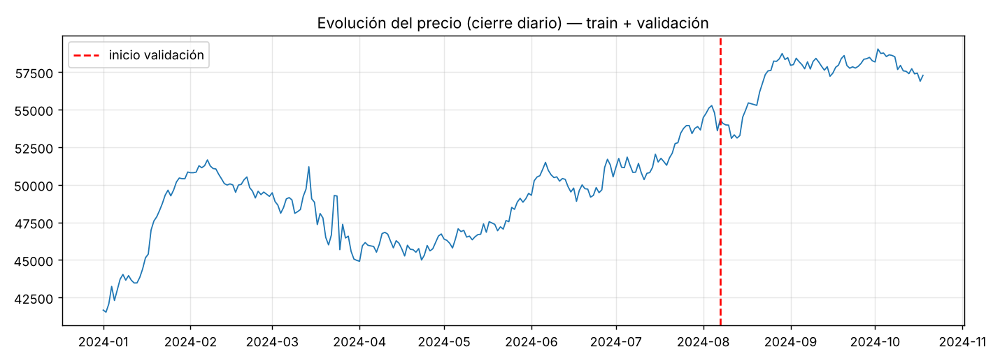</p>

**2. Distribución de retornos.** Histograma de retornos logarítmicos de 1 barra (eje vertical logarítmico) contra una normal
equivalente. Las colas son más pesadas que las de la normal (curtosis en exceso ≈ 17): los movimientos extremos son más
frecuentes de lo que supone una gaussiana. Por eso los indicadores se recortan a ±5 desviaciones tras escalar.
<p align="center">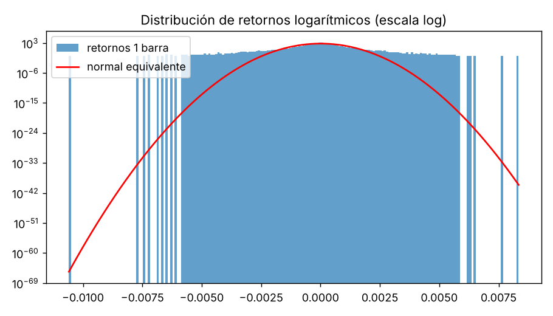</p>

**3. Regímenes de volatilidad.** La volatilidad realizada diaria alterna entre períodos calmos y picos (el mayor, en marzo). Las
líneas punteadas son los terciles. Justifica incluir `vol` en el estado: indica cuándo el costo de operar pesa más frente al
movimiento esperado.
<p align="center">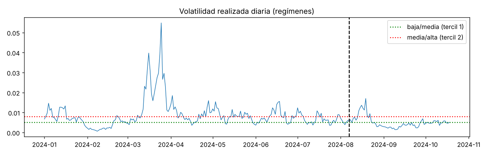</p>

**4. Perfil intradía.** |Retorno| medio y volumen medio por minuto del día. Son casi planos: el generador sintético no tiene la
forma de "U" típica de acciones. La caída a 0 en el primer minuto es un artefacto esperado, porque los indicadores se reinician
cada día. Con datos reales este perfil es el que justifica la variable `tod`.
<p align="center">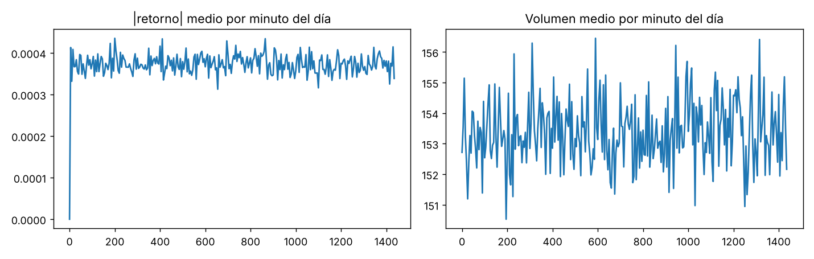</p>

**5. Drawdown de comprar y mantener.** Pérdida acumulada desde el máximo previo (cierres diarios; máximo cercano a −13 %). Es la
referencia contra la cual leer el máximo drawdown del agente.
<p align="center">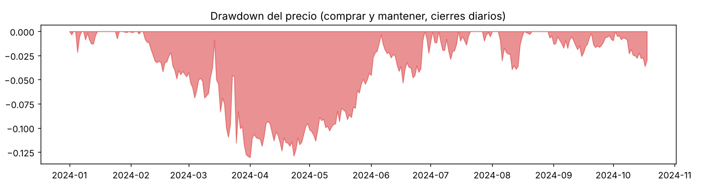</p>

**6. Autocorrelación de retornos.** Solo el rezago 1 sobresale (≈ −0,047): hay una reversión leve entre barras consecutivas,
que `ret_1` puede capturar. Los demás rezagos quedan en torno a las bandas de ruido.
<p align="center">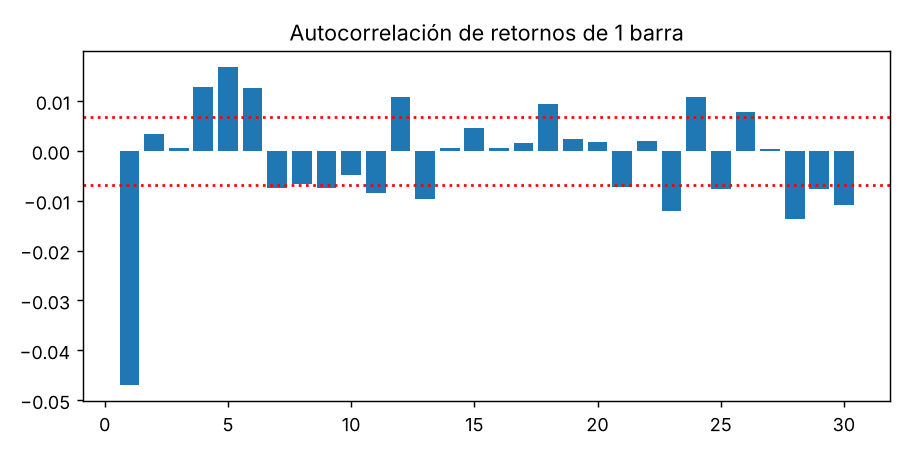</p>

**7. Distribución de los indicadores (train).** Los retornos y `dist_sma` están centrados en 0 con colas pesadas, `vol` es
asimétrica a la derecha, `rsi` y `tod` están acotados en [−1, 1] y `vol_z` es aproximadamente normal. Motivo de escalar con la
media y desviación de **entrenamiento** y recortar valores extremos.
<p align="center">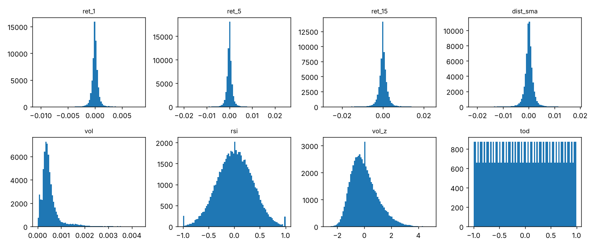</p>

**8. Correlación entre indicadores.** `ret_5`, `ret_15`, `dist_sma` y `rsi` están fuertemente correlacionados (hay información
redundante); `vol`, `vol_z` y `tod` son casi independientes del resto y aportan información distinta.
<p align="center">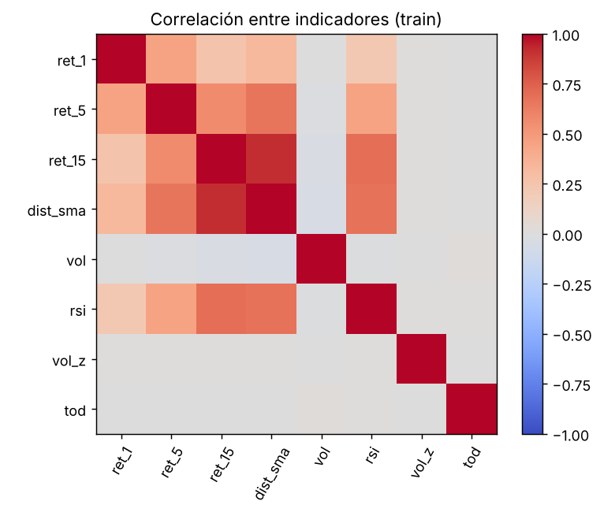</p>

**9. Indicador(t) frente al retorno(t→t+1).** Ninguna correlación supera ≈ 0,05 en valor absoluto; la más fuerte es la de
`ret_1` (negativa, coherente con la reversión de la figura 6). La señal predictiva es mínima: el agente tiene muy poca ventaja
que explotar y los costos de transacción pueden anularla.
<p align="center">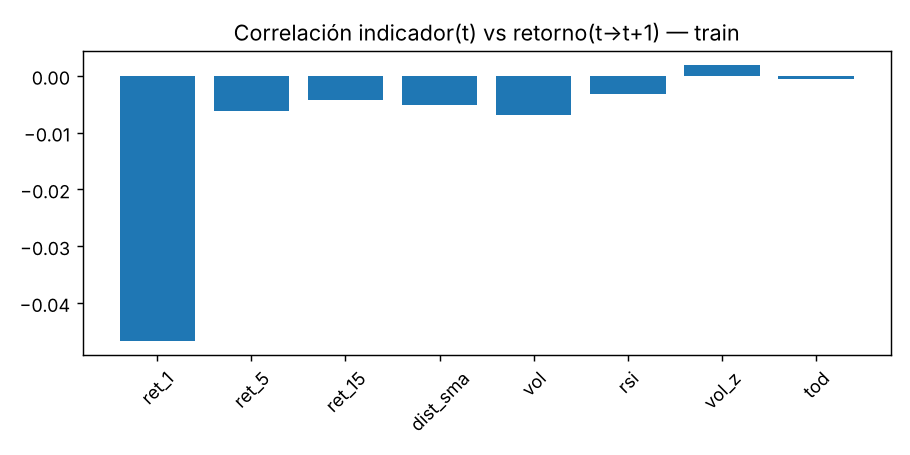</p>


## Paso 2 · Entorno de simulación con costo por operar

`src/environment.py` implementa `TradingEnv` con la interfaz Gymnasium (`reset`, `step`):

```python
obs, info = env.reset()
while not done:
    action = agent.act(obs)
    obs, reward, terminated, truncated, info = env.step(action)
    done = terminated or truncated
```

**Timing (lookahead-safe).** El agente decide al cierre de la barra `t` con información `≤ t`, la orden se ejecuta a
`close[t]` y la ganancia o pérdida del paso es el movimiento `close[t] → close[t+1]`:

```
V_{t+1} = V_t · (1 − c·|p' − p|) · (1 + p'·r_{t+1})        c = (fee_bps + slippage_bps) / 10⁴
```

* **Costo:** `fee_bps + slippage_bps` por unidad de turnover (default 1 + 1 bps; es un supuesto de scalping, no el de
  10 bps del ejemplo del enunciado). Cambiarlo con `--set env.fee_bps=… --set env.slippage_bps=…`.
* **Cierre diario:** en la última barra de cada día la posición se fuerza a 0 (se paga el costo) y no se gana el gap overnight.
* **Rezago de ejecución:** `env.execution_lag=1` ejecuta la orden una barra después (más realista; prueba de robustez).
* **Ruina:** en **entrenamiento** el episodio termina si el capital cae bajo `env.ruin_fraction` del inicial. En
  **evaluación** esa regla se desactiva para que todas las estrategias recorran el período completo.
* `tests/test_env.py` verifica costos, timing, cierre diario, rezago y consistencia de la recompensa.

## Paso 3 · Diseñar e iterar la función de recompensa

Tres versiones, seleccionables con `reward.name` (los retornos por barra son ~1e-4; `reward.scale` los multiplica):

| Versión | Definición | Idea |
|---|---|---|
| `v1_return` | `(V_{t+1} − V_t) / V_t` | retorno neto por barra, incluye costos |
| `v2_turnover` | `log(V_{t+1}/V_t) − λ·turnover` | castiga operar de más (`reward.turnover_penalty`) |
| `v3_risk` | `v2 − μ·máx(0, aumento de drawdown)` | además castiga profundizar el drawdown (`reward.drawdown_penalty`) |

Ciclo de iteración: entrenar → observar el comportamiento → identificar problemas (¿opera en exceso?, ¿se queda fuera
del mercado?, ¿asume demasiado riesgo?, ¿*reward hacking*?) → modificar → reentrenar → comparar en **validación**:

```bash
python -m src.experiments --rewards v1_return v2_turnover v3_risk --seeds 0 1 2
# -> runs/<recompensa>_s<semilla>/ y reports/reward_comparison_val.{md,csv,png}
```

**Resultado preliminar** (SPY, velas de 5 min, ~59 días, **validación**, 2 semillas; ver [Datos](#datos)):

| Estrategia (validación) | Retorno acum. | Máx. drawdown | Costos ($) | Nº cambios | % invertido |
|---|---|---|---|---|---|
| RL `v1_return` | −0.45 % ± 0.49 | −0.91 % ± 0.48 | 978 | 70 | 50 % |
| RL `v2_turnover` | 0.14 % ± 0.07 | −0.83 % ± 1.11 | 239 | 16 | 34 % |
| RL `v3_risk` | 0.04 % ± 0.05 | −0.02 % ± 0.02 | 10 | 1 | 0 % |
| Aleatorio (media de 10) | −8.10 % | −8.16 % | 8,021 | 628 | 66 % |
| Comprar y mantener | −0.06 % | −2.04 % | 20 | 1 | 100 % |
| Cruce de medias | −0.22 % | −1.16 % | 801 | 40 | 52 % |

A más penalización, menos operaciones: `v1` opera de más, `v2` equilibra y `v3` es tan pasiva que se queda fuera del
mercado (comportamiento inesperado a analizar). Con ~8 días de validación y 2 semillas las diferencias entre agentes no
son estadísticamente distinguibles de 0; **reemplaza esta tabla con la del dataset oficial**.

### Ejemplo de iteración: dataset sintético cripto, 10 bps vs 2 bps

Misma comparación de recompensas (3 versiones × 3 semillas, 100 000 pasos, **validación**) con dos niveles de costo. Tablas tomadas
de la salida de `src.experiments` en el notebook de la corrida (media ± desviación entre semillas):

| Validación | Costo 10 bps | Costo 2 bps |
|---|---|---|
| RL `v1_return` | 2,58 % ± 1,60 · 10 cambios · 6 % invertido | 0,54 % ± 1,73 · 316 cambios · 72 % invertido |
| RL `v2_turnover` | 1,59 % ± 1,84 · 8 cambios · 4 % invertido | **8,22 % ± 2,73** · 148 cambios · 63 % invertido |
| RL `v3_risk` | 0,00 % · 0 cambios · 0 % invertido | 0,06 % ± 0,10 · 3 cambios · 0 % invertido |
| Comprar y mantener | 6,61 % | 6,70 % |
| B&H intradía | −7,77 % | 3,58 % |
| Cruce de medias | −52,86 % | −9,55 % |
| Aleatorio (media de 10) | −99,99 % | −84,21 % |

**Con 10 bps** (curvas de la semilla 0 de cada recompensa): `v1` hace unas pocas operaciones al inicio y luego queda plano
(≈ +1,8 %); `v2` y `v3` permanecen en ≈ 100 000 (las curvas se superponen). Con ese costo operar no compensa y ningún agente
supera a comprar y mantener.
<p align="center">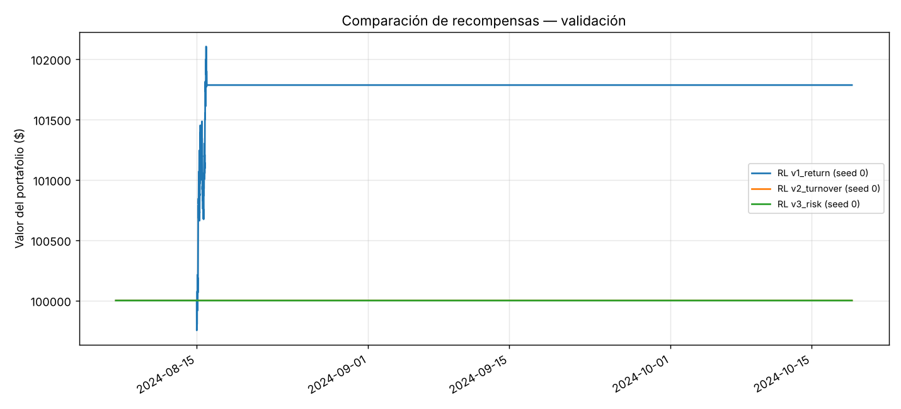</p>

**Con 2 bps** (semilla 0): `v2_turnover` sube a escalones, con tramos planos entre operaciones, y llega a ≈ +5 %; `v1_return`
oscila alrededor del capital inicial sin ventaja clara; `v3_risk` sigue plana.
<p align="center">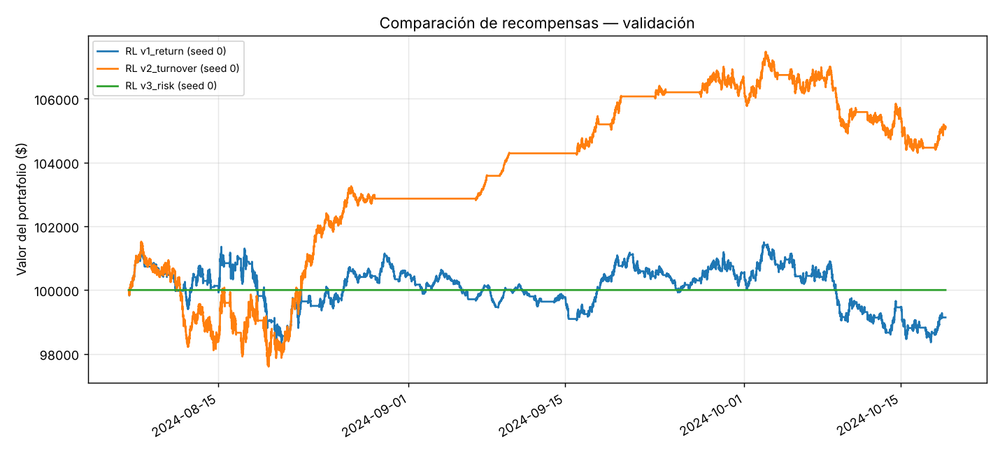</p>

**Lectura.** (1) El costo cambia el comportamiento aprendido: con 10 bps el agente casi no opera; con 2 bps opera más. (2) La
penalización por turnover (`v2`) fue la que mejor funcionó al bajar el costo. (3) `v3_risk` es un caso de *reward hacking*:
castigar el drawdown además del turnover hace que la política que maximiza la recompensa sea no operar. (4) La desviación
entre semillas es del orden de la media, así que con 3 semillas las diferencias entre `v1` y `v2` son frágiles.

## Paso 4 · Entrenar el agente (DQN)

`src/agent.py` (red, replay buffer, Double DQN) y `src/train.py` (bucle de entrenamiento). Hiperparámetros por defecto
(`configs/default.yaml → dqn`; los ajustes por dataset van con `--set`):

| Parámetro | Valor |
|---|---|
| Arquitectura | MLP de 2 capas ocultas `[128, 128]`, ReLU |
| Learning rate · batch · γ | 1e-4 · 128 · 0.99 |
| Pasos · inicio de aprendizaje · frecuencia | 150 000 · 5 000 · cada 4 pasos |
| Replay buffer · actualización de red objetivo | 100 000 · cada 1 000 pasos |
| Exploración | ε-greedy lineal 1.0 → 0.05 durante `eps_decay_fraction` (50 %) de los pasos |
| Episodio de entrenamiento | ventanas aleatorias de `episode_len` barras (780 por defecto) |
| Criterio de parada | parada anticipada por validación (`patience`) |
| Semillas | `seed` en el YAML o `--seed` |

**Selección del checkpoint.** La validación (nunca el test) elige el mejor checkpoint (`dqn.selection_metric`: `return`
o `calmar`), y **solo se consideran evaluaciones posteriores al fin del decaimiento de ε**. Sin esa condición, un
checkpoint temprano casi sin entrenar que se queda 100 % fuera del mercado (retorno 0 %) ganaba por defecto frente a
políticas que operaban y perdían un poco.

```bash
python -m src.train --reward v2_turnover --seed 0 --out runs/v2_turnover_s0
```

## Paso 5 · Evaluar en datos no vistos contra baselines

**Protocolo.** División cronológica por días completos: 60 % entrenamiento · 20 % validación · 20 % test (held-out).
El agente aprende con el entrenamiento; recompensa, hiperparámetros y checkpoint se deciden con la validación; el test
se usa **una sola vez**, al final, con el agente ya definido. `evaluate.py` exige `--final` para tocar el test.

**Baselines** (mismos datos y costos que el agente): agente **aleatorio** (media de `evaluation.random_seeds` semillas),
**comprar y mantener** (una compra al inicio, incluye gaps overnight), **B&H intradía** (100 % invertido en el mismo
entorno que el agente, con cierre diario) y **cruce de medias móviles**.

**Métricas:** retorno acumulado, máximo drawdown, costos de transacción (más Sharpe anualizado, nº de cambios de
posición y % de tiempo invertido), con curva de capital y evolución de posiciones.

```bash
python -m src.evaluate --run runs/v2_turnover_s0 --split val                  # diagnóstico en validación
python -m src.evaluate --run runs/v2_turnover_s0 --split test --final         # held-out: UNA sola vez
```

Genera en `runs/<run>/eval_<split>/`: `metrics.md/csv`, `equity_curves.png`, `positions.png` y
`position_by_time_of_day.png`.

**Robustez** (recomendada en scalping, el costo domina el resultado):

```bash
python -m src.evaluate --run runs/v2_turnover_s0 --split val --cost-bps 0.5
python -m src.evaluate --run runs/v2_turnover_s0 --split val --cost-bps 5
python -m src.evaluate --run runs/v2_turnover_s0 --split val --set env.execution_lag=1
```

### Resultados ilustrativos (dataset sintético cripto)

Corrida de ejemplo del notebook: 365 días × 288 velas de 5 min, división 60/20/20 (el test arranca a fines de octubre).
En validación se eligió, por cada nivel de costo, el mejor agente (10 bps: `v1_return` semilla 1; 2 bps: `v2_turnover`
semilla 2). Cada curva compara al agente con los cuatro baselines bajo las mismas condiciones. Como el agente se eligió mirando
la validación, **su resultado en validación está inflado por selección**; la medida honesta es la del test.

**Validación con costo de 10 bps** (`v1_return`, semilla 1). El agente (+4,4 %) opera poco: pasa ≈ 15 % del tiempo invertido,
en un solo tramo de unas 18 h en los primeros días, y con costos altos no supera a comprar y mantener (+6,6 %). El B&H intradía
(−7,8 %) y el cruce de medias (−53 %) pierden por pagar costos en cada cambio, y el aleatorio se arruina.
<p align="center">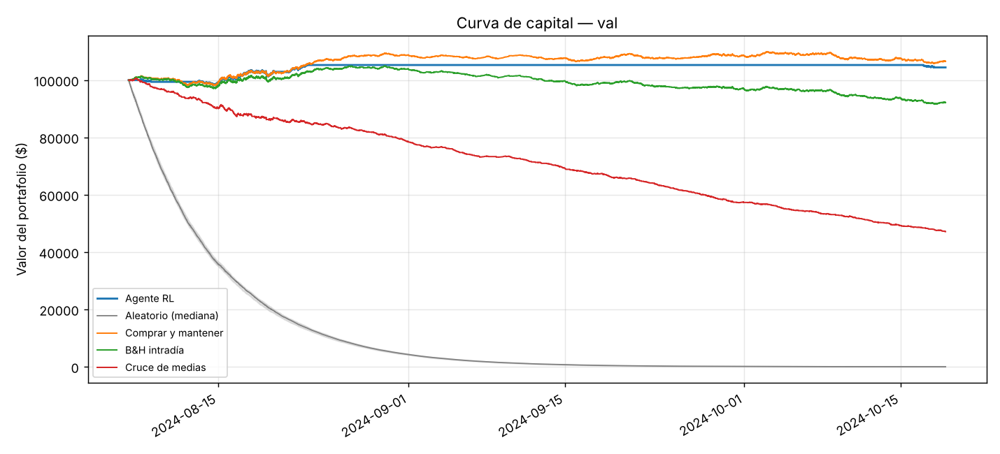</p>

<p align="center">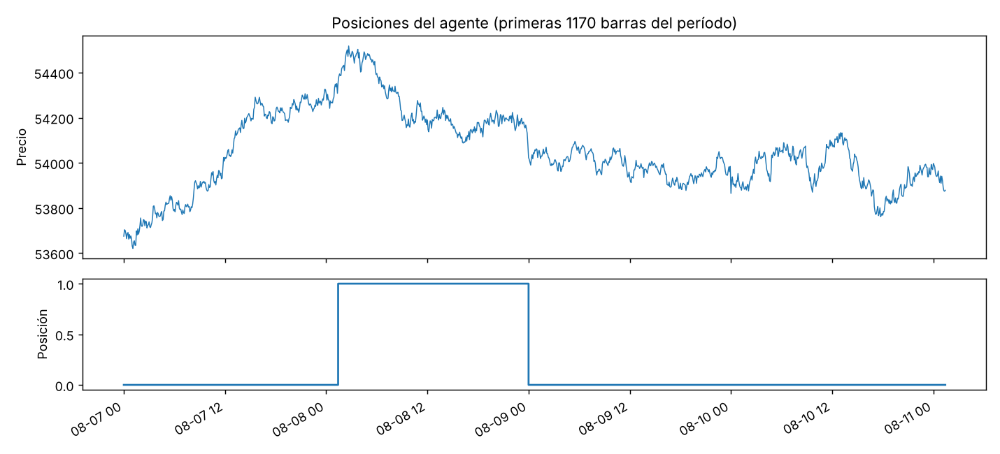</p>

El perfil por hora muestra que casi todos los cambios ocurren en el primer intervalo del día (00:00 UTC), cuando se fuerza el
cierre diario y el agente decide si reentra; el resto del día mantiene su posición.
<p align="center">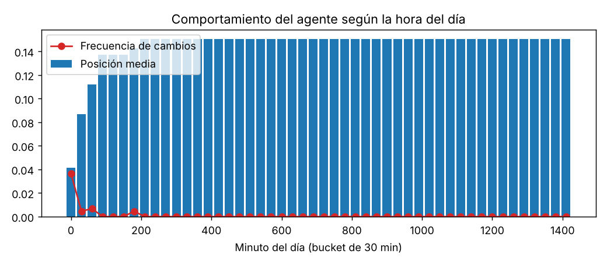</p>

**Validación con costo de 2 bps** (`v2_turnover`, semilla 2). Con costos bajos el agente (≈ +10,2 %, Sharpe 4,88) supera a
comprar y mantener (+6,7 %), a B&H intradía y al cruce de medias. Permanece invertido la mayor parte del tiempo y cae a 0 en
cada cierre diario (00:00 UTC), como exige el scalping sin posiciones overnight.
<p align="center">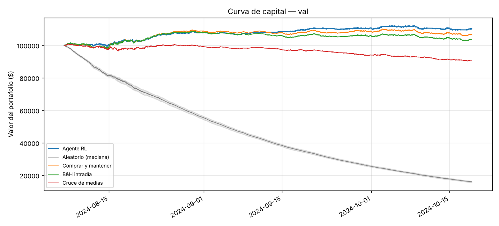</p>

<p align="center">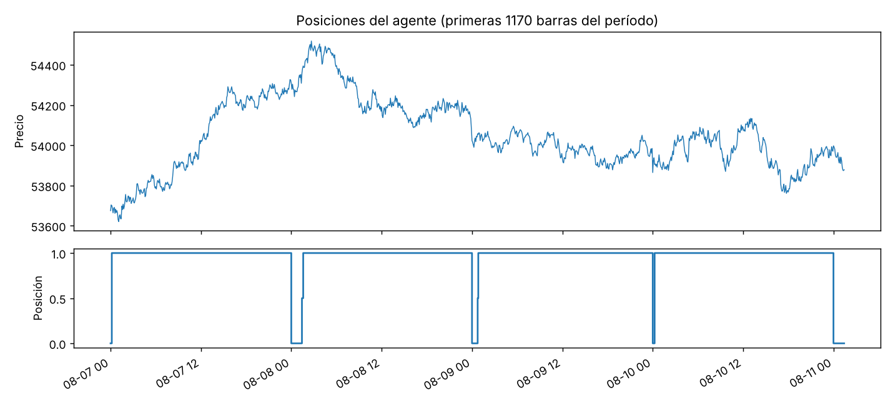</p>

La posición media sube durante las primeras horas del día (reentrada tras el cierre forzado) y se estabiliza en ≈ 0,8; la
frecuencia de cambios se concentra en el primer intervalo.
<p align="center">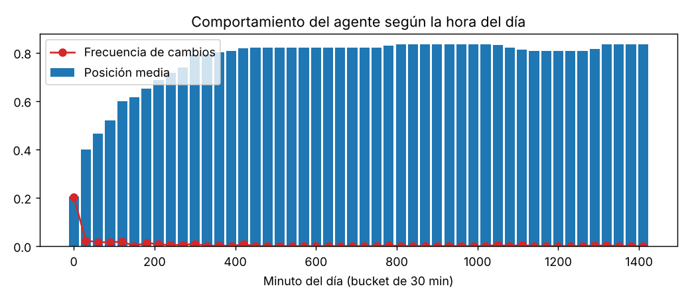</p>


**Robustez** (agente `v2_turnover` semilla 2, validación):

| Costo (bps) | Retorno RL | Sharpe RL | Retorno B&H | ¿RL > B&H? |
|---|---|---|---|---|
| 2 | +10,18 % | 4,88 | +6,70 % | Sí |
| 5 | +6,06 % | 2,96 | +6,67 % | No, por poco |
| 10 | −0,47 % | −0,18 | +6,61 % | No |
| 20 | −12,36 % | −5,85 | +6,51 % | No |

La ventaja del agente desaparece entre 2 y 10 bps: B&H paga el costo una sola vez y el agente en cada cambio de posición.
Con `execution_lag=1` (orden ejecutada una barra después) el resultado se mantiene (+10,82 %, Sharpe 5,17), así que la estrategia
no depende de un timing exacto.

**Test held-out** (se evalúa con `--final`, ya con el agente definido). El período de test es **bajista** (comprar y mantener:
≈ −13 %), por lo que todas las estrategias pierden; la pregunta es cuánto pierde cada una frente a las demás.

| Estrategia (test) | Costo 10 bps (`v1_return` s1) | Costo 2 bps (`v2_turnover` s2) |
|---|---|---|
| Agente RL | −20,57 % (DD −21,00 %, 80 cambios) | −13,90 % (DD −15,86 %, 199 cambios) |
| Comprar y mantener | −13,10 % | −13,03 % |
| B&H intradía | −24,59 % | −15,31 % |
| Cruce de medias | −58,17 % | −16,80 % |
| Aleatorio (media de 30) | −99,99 % | −85,62 % |

Con 10 bps el agente pierde más que comprar y mantener (−20,6 % frente a −13,1 %): su curva sigue de cerca la del B&H intradía
durante gran parte del período (pagando costos en cada cierre y reentrada) y queda casi plana desde mediados de diciembre. En
los primeros cuatro días estuvo fuera del mercado y entró recién al final de ese tramo.
<p align="center">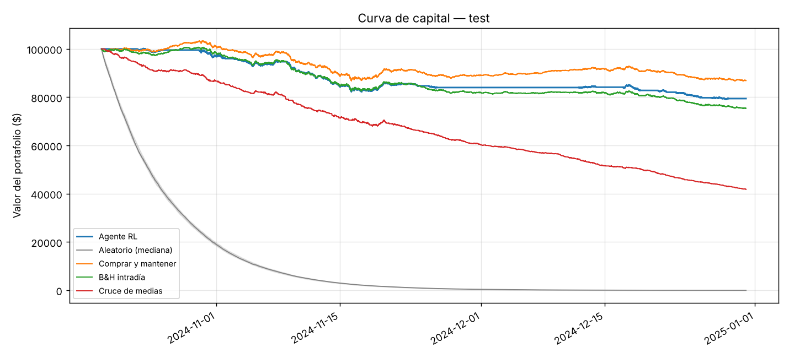</p>

<p align="center">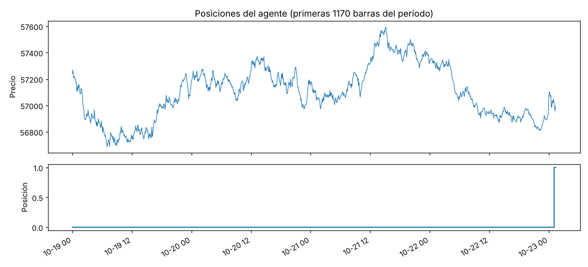</p>

Con 2 bps el agente prácticamente empata con comprar y mantener (−13,9 % frente a −13,0 %): la ventaja de la validación no se
sostuvo en el test, pero tampoco hubo un colapso. Está invertido casi todo el tiempo y sale a 0 en cada cierre diario.
<p align="center">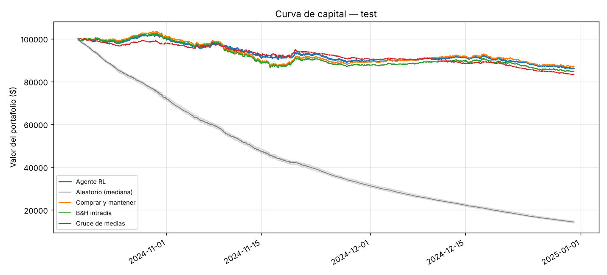</p>

<p align="center">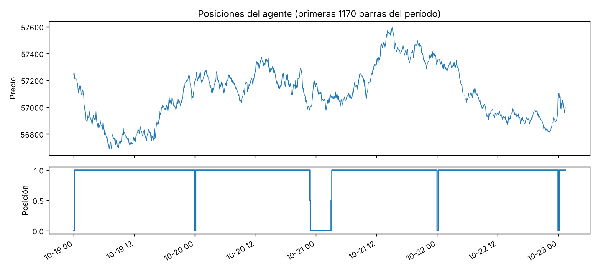</p>

**Qué concluir (y qué no).** La ventaja observada en validación no se trasladó al test: el régimen cambió de mixto a bajista, y
el agente, elegido por su desempeño en validación, no se adaptó. Es un resultado negativo válido, no un fallo del
procedimiento. Precauciones al reportarlo: (i) los datos son sintéticos; (ii) el "mejor agente" sale de elegir entre 9 runs en
validación; (iii) aquí se evaluó el test dos veces, una por escenario de costo y con agentes distintos; para el informe oficial
conviene fijar un único agente y un único escenario antes de abrir el test.

## Paso 6 · Discutir y reflexionar

Se documenta en el informe (§9 discusión y limitaciones, §10 reflexión individual). Puntos a cubrir:

* ¿Se respondió la pregunta central, incluso con resultado negativo? Diferencia entre train, validación y test.
* Comportamientos inesperados: p. ej. un agente que se queda fuera del mercado, o cuya validación empeora mientras
  la pérdida de entrenamiento baja (sobreajuste con pocos datos).
* Limitaciones: un solo activo, período acotado, no estacionariedad, costos supuestos, ejecución al cierre, varianza
  entre semillas, riesgo de sobreajustar a la validación.
* Reflexión individual (5 preguntas): resultado sorprendente, decisión metodológica de mayor impacto, qué se cambiaría,
  comportamiento no explicado y diferencia entre lo aprendido en RL y su aplicación aquí.

## Instalación, datos y reproducibilidad

```bash
python -m venv .venv && source .venv/bin/activate      # Windows: .venv\Scripts\activate
pip install -e ".[dev]"                                 # numpy, pandas, gymnasium, torch, matplotlib, pyyaml, pytest
python -m pytest -q                                     # anti-lookahead + mecánica del entorno
```

### Datos

CSV con columnas `timestamp, open, high, low, close, volume` (se aceptan alias como `datetime`, `date`, `apertura`,
`cierre`). Debe ser **intradía** (1, 5 o 15 min); con datos diarios el código se detiene con un aviso, porque scalping
requiere varias barras por día.

1. Copia el archivo a `data/` y pon `data.path: data/<archivo>.csv` en `configs/default.yaml` (o usa `--set data.path=…`).
2. Ajusta a la frecuencia y sesión del activo: `data.session_start`, `data.session_minutes`,
   `evaluation.bars_per_year` y `dqn.episode_len`. Valores por defecto para velas de **1 min** de una sesión de 390 min
   (252 días × 390 = 98 280). Para velas de **5 min**: `bars_per_year=19656` y `episode_len=156`.
3. Si no se dispone del dataset del profesor, para pruebas se puede descargar SPY a 5 minutos con `yfinance`
   (Yahoo solo entrega ~60 días: sirve para verificar el pipeline, no para una evaluación seria).

### Semillas

`seed` (YAML o `--seed`) fija Python, NumPy y PyTorch; el buffer, la exploración ε y el entorno usan generadores derivados
de esa semilla. El agente aleatorio usa semillas `1000 + i`; los datos sintéticos, `data.synthetic.seed`. En CPU los
resultados son reproducibles con las mismas versiones de librerías. Cualquier valor del YAML se puede sobrescribir con
`--set clave=valor`. Reporta media ± desviación sobre varias semillas.

## Ejecución en Google Colab

Para el dataset de [`gym-trading-env`](https://gym-trading-env.readthedocs.io/en/latest/download.html) (velas de cripto
descargadas con `gym_trading_env.downloader`), usa el notebook completo **`notebooks/colab_gym_trading_env.ipynb`**
(Colab → Archivo → Subir cuaderno): descarga los datos, los convierte al CSV del proyecto, ajusta los parámetros a un
mercado 24/7 y ejecuta EDA, comparación de recompensas, evaluación y robustez. Para SPY con `yfinance`, usa las celdas
de abajo.

**Transferencia (sin reentrenar):** `notebooks/colab_transfer_spy.ipynb` toma los agentes ya entrenados con cripto y los
evalúa sobre SPY de Yahoo con `python -m src.transfer --runs runs/<run> ... --data data/spy_5m.csv --cost-bps 2`.
Usa la config, el checkpoint y el escalador de cada run; es una prueba fuera de distribución, no el test held-out.

```python
# 1) clonar e instalar
!git clone https://github.com/osdato98-sys/invest-app-rl.git
%cd invest-app-rl
!pip install -q gymnasium pytest yfinance
!python -m pytest -q
```
```python
# 2) datos de prueba: SPY a 5 minutos (si ya tienes el CSV del profesor, súbelo a data/ y define DATA)
import yfinance as yf
raw = yf.download("SPY", period="59d", interval="5m", auto_adjust=False, progress=False)
raw.columns = raw.columns.get_level_values(0)
df = raw.reset_index().rename(columns={"Datetime": "timestamp"})[["timestamp","Open","High","Low","Close","Volume"]]
df.columns = ["timestamp","open","high","low","close","volume"]
df.to_csv("data/spy_5m.csv", index=False)

DATA = "data/spy_5m.csv"
PARAMS = ("--set evaluation.bars_per_year=19656 --set dqn.episode_len=156 "
          "--set dqn.total_steps=60000 --set dqn.eval_every=10000 --set dqn.patience=4 "
          "--set dqn.eps_decay_fraction=0.3")
```
```python
# 3) EDA y comparación de recompensas (validación)
!python -m src.eda --set data.path={DATA}
!python -m src.experiments --rewards v1_return v2_turnover v3_risk --seeds 0 1 --set data.path={DATA} {PARAMS}
print(open("reports/reward_comparison_val.md").read())
```
```python
# 4) evaluar un run elegido en validación; el test solo al final (--final)
RUN = "runs/v2_turnover_s0"
!python -m src.evaluate --run {RUN} --split val
# !python -m src.evaluate --run {RUN} --split test --final
```
```python
# 5) guardar resultados antes de que se cierre la sesión (runs/ no se sube a git)
!zip -qr resultados.zip runs reports
from google.colab import files
files.download("resultados.zip")
```

## Estructura del repositorio

```
configs/default.yaml     todos los parámetros (datos, costos, recompensa, DQN, evaluación)
src/data.py              carga, indicadores causales, scaler (solo train), split temporal, generador sintético
src/environment.py       TradingEnv (Gymnasium): timing, costos, cierre diario, 3 recompensas
src/agent.py             DQN / Double DQN, replay buffer, red MLP
src/train.py             entrenamiento; la validación decide checkpoint y parada anticipada
src/baselines.py         aleatorio, comprar y mantener, cruce de medias
src/metrics.py           episodio completo y métricas (retorno, drawdown, costos, Sharpe, ...)
src/evaluate.py          agente + baselines, tablas y gráficos (protege el test con --final)
src/experiments.py       comparación de versiones de recompensa en validación
src/transfer.py          evalúa runs ya entrenados sobre otro dataset (p. ej. SPY de Yahoo), sin reentrenar
src/eda.py               análisis exploratorio (solo train + validación)
tests/                   anti-lookahead y mecánica del entorno
notebooks/eda.ipynb      EDA interactivo
notebooks/colab_gym_trading_env.ipynb   flujo completo en Colab con datos de gym-trading-env (cripto)
notebooks/colab_transfer_spy.ipynb      agentes entrenados con cripto evaluados sobre SPY (Yahoo)
docs/figures/                           figuras del README (EDA, recompensas, evaluación y test de la corrida de ejemplo)
informe/informe.md       plantilla del informe con todas las secciones pedidas
```
## Reflexión 

Empezamos con una pregunta sencilla: ¿puede un agente de aprendizaje por refuerzo decidir mejor que una regla simple cuánto dinero tener invertido? Con nuestros datos, la respuesta honesta es que no. En el periodo de prueba, que el agente nunca vio, comprar y mantener perdió -13,10 % con costos de 10 bps y nuestro agente perdió -20,57 %; con 2 bps el agente perdió -13,90 % frente a -13,03 %. Sí le fue mejor que la versión de comprar y mantener que cierra cada día, que es la comparación más justa porque tiene nuestra misma regla, pero no logramos superar la vara principal.

Lo que más nos enseñó el proyecto fue el peso de los costos. La misma recompensa produjo comportamientos opuestos según lo que costaba operar: con 10 bps el agente aprendió casi a no hacer nada, y con 2 bps operó mucho más y en validación parecía ganarle al mercado. Cuando probamos ese mismo agente con costos más altos, la ventaja se esfumó antes de llegar a 10 bps. Entendimos que, en una estrategia que entra y sale todos los días, el costo no es un detalle del simulador: es la variable que define si la idea tiene sentido.

La iteración de la recompensa también nos dejó lecciones. La primera versión, el retorno neto, llevaba al agente a operar de más. Al agregar un castigo por cambiar de posición, el comportamiento se volvió más ordenado y fue la versión que mejor funcionó con costos bajos. La tercera versión, que además castigaba las caídas, terminó en un agente que prefería no invertir nunca. Aprendimos que una recompensa puede ser razonable en el papel y aun así hacer que la mejor "jugada" sea quedarse quieto. Más que reward hacking en sentido estricto, fue un castigo mal calibrado frente al tamaño de las ganancias.

Hay cosas que haríamos distinto. Primero, definiríamos el criterio de éxito antes de mirar resultados y fijaríamos un solo agente y un solo costo antes de abrir el test; nosotros terminamos evaluando el test dos veces, con agentes distintos, y eso debilita la conclusión. Segundo, trabajaríamos con datos reales de mercado: los resultados principales salieron de una serie sintética, útil para comprobar que todo funciona, pero no para decir nada sobre un mercado de verdad. Tercero, usaríamos más semillas, porque la diferencia entre ellas fue casi del mismo tamaño que el resultado promedio. Cuarto, elegiríamos el modelo con una medida que combine retorno y riesgo, y no solo el retorno.

Nos queda un comportamiento sin explicar del todo: en un test bajista el agente podía salirse a 0 % y protegerse, pero con 2 bps estuvo invertido casi todo el tiempo. Creemos que aprendió un patrón del periodo de validación, que fue mixto, y no supo reconocer que el mercado había cambiado.

La lección más importante fue sobre el planteamiento del problema. Pasamos mucho tiempo en el código, y está bien hecho: las pruebas automáticas muestran que el agente no usa información del futuro y que los costos se cobran bien. Pero las decisiones que más pesaron en el resultado no fueron técnicas, sino de planteamiento: operar dentro del día, qué costo suponer, qué contar como éxito y contra quién compararnos. Si volviéramos a empezar, dedicaríamos más tiempo a esas preguntas antes de entrenar el primer agente.


## Referencias

* Sutton, R. S., & Barto, A. G. (2018). *Reinforcement learning: An introduction* (2.ª ed.). MIT Press.
* Powell, W. B. (2019). *Reinforcement learning and stochastic optimization*. Wiley.
* Schulman, J., et al. (2017). Proximal policy optimization algorithms. arXiv:1707.06347.
